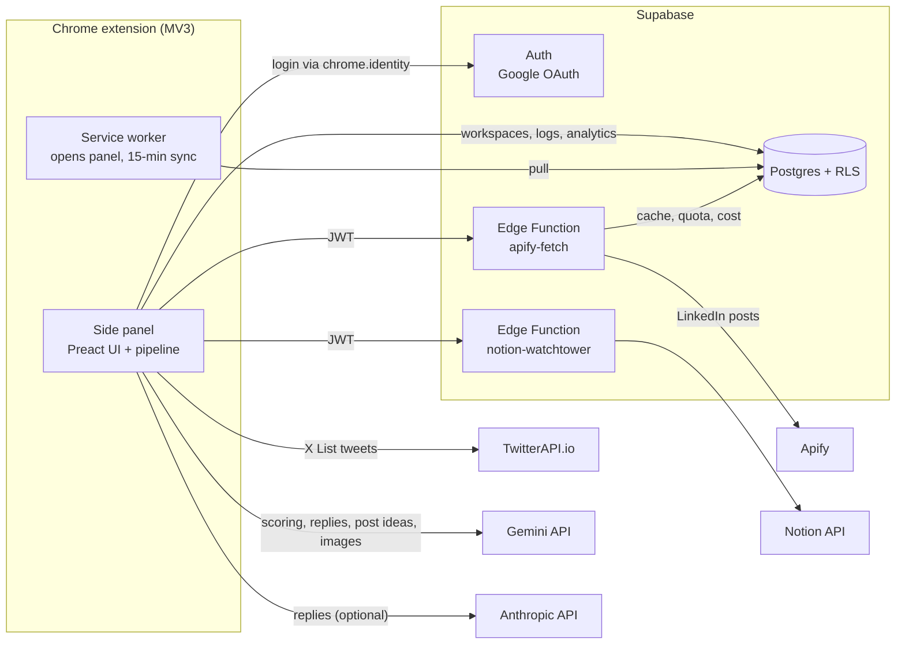

# Replai

A Chrome side-panel extension that finds the posts on X and LinkedIn worth replying to and drafts replies in your brand's voice.

[](https://github.com/thxcabra/replai/actions/workflows/ci.yml)

[](LICENSE)

## Overview

I built Replai for the social media team at MOIC Digital. Analysts follow curated X Lists and LinkedIn profiles for each client, and most of their time went into scrolling feeds to find the few conversations worth joining. Replai pulls those feeds into a side panel, drops the noise with cheap mechanical filters, ranks what is left with an LLM, and writes 2–3 reply drafts per post in the voice configured for that workspace.

The analyst stays in control. Replai never posts anything itself: it opens X's reply or quote composer with the draft filled in, or copies the LinkedIn comment and opens the original post. After posting, the analyst can paste the reply URL so the reply counts as verified in the team analytics.

## Features

- **Two channels**
  - **X:** tweets from one or more X Lists per workspace, fetched through [TwitterAPI.io](https://twitterapi.io).
  - **LinkedIn:** recent posts from "bridge" profiles, people who already engage with the account you want to reach. Profiles come from a Groundswell bundle (a `.zip` export of an offline network analysis) or a plain CSV list ([template](public/modelo-lista-linkedin.csv)). Posts are scraped by Apify through a Supabase Edge Function that holds the token, caches results, caps daily runs and logs cost.
- **Pre-filter without an LLM:** drops tweets outside the time window, without text, too short, pure retweets, in unwanted languages, from automated accounts, or (in strict mode) from authors missing from the social graph.
- **Scoring:** one batched Gemini 2.5 Flash call scores each remaining tweet for persona relevance and engagement potential (0–100), so the best candidates come first.
- **Triage, then generate:** analysts pick what to answer in a swipe or list view. Replies are generated only for the selected posts, which keeps token spend down.
- **Reply drafts:** 2–3 editable suggestions per post from Gemini 2.5 Flash or Anthropic Claude (provider and Claude model are chosen in Settings), with per-reply regeneration, quote-tweet support, tweet images sent to the model, and optional reference links as extra context.
- **Workspaces and voice:** one workspace per client or brand, each with its own lists, filters, persona and voice. Voice can be typed or uploaded as `.md`, `.txt` or `.pdf`, and every change is versioned (`voice_versions`) so replies can be traced back to the voice that produced them. Workspaces sync across devices through Supabase.
- **Post ideas:** a Posts tab suggests original posts by combining a daily Notion digest page (read through the `notion-watchtower` Edge Function), the most viral posts in the list and the analyst's recent replies. Each suggestion gets a Gemini-generated image when one is available.
- **Admin analytics:** admins get a team overview, per-analyst stats, role management, LinkedIn/Apify cost tracking, and CSV/JSON exports of reply, post, session and event logs.

## Architecture



- The side panel runs the whole pipeline: fetch, pre-filter, score, generate. LLM calls go straight from the browser to Gemini or Anthropic with the user's own key.
- The service worker opens the side panel and pulls workspace changes from Supabase every 15 minutes (`chrome.alarms`).
- Tokens that should never reach the client (Apify, Notion) live in Supabase secrets. Both Edge Functions verify the user's JWT and email domain before calling the upstream API, and their CORS headers only allow the extension's origin.
- Every table has Row-Level Security. Users see their own rows; admins (`user_roles`) can read across the team for analytics.

More detail (in Portuguese) in [docs/ARCHITECTURE.md](docs/ARCHITECTURE.md).

## Tech stack

| Area | Tools |
|---|---|
| Extension | Chrome Manifest V3, side panel API, `chrome.identity`, `chrome.alarms` |
| UI | Preact 10, Tailwind CSS v4 |
| Build | Vite 6, [@crxjs/vite-plugin](https://github.com/crxjs/chrome-extension-tools), TypeScript (strict) |
| Backend | Supabase: Auth (Google OAuth), Postgres with RLS (15 migrations), Edge Functions (Deno) |
| LLMs | Gemini 2.5 Flash (default, plus Gemini image models), Anthropic Claude (optional) |
| Data sources | TwitterAPI.io (X Lists), Apify (LinkedIn posts), Notion API |
| Other | `@supabase/supabase-js`, `pdfjs-dist` (voice files in PDF) |

## Getting started

### Prerequisites

- Node.js 22.6 or newer (`npm test` uses `--experimental-strip-types`)
- Chrome 114+
- A Supabase project (see [Supabase setup](#supabase-setup))

### Install and build

```bash
git clone https://github.com/thxcabra/replai.git
cd replai
npm ci
cp env/.env.example env/.env   # then fill in the values below
npm run build                  # type-check + production build into dist/
```

Load it in Chrome: open `chrome://extensions`, turn on **Developer mode**, click **Load unpacked** and pick `dist/`. Click the Replai icon to open the side panel.

### Environment variables

Vite reads `env/.env` (gitignored). Every `VITE_*` value is embedded in the built JavaScript, so treat anything you put there as public to whoever has the build.

| Variable | Required | Purpose |
|---|---|---|
| `VITE_SUPABASE_URL` | yes | Supabase project URL |
| `VITE_SUPABASE_ANON_KEY` | yes | Supabase anon key (public by design; RLS protects the data) |
| `VITE_ALLOWED_EMAIL_DOMAIN` | no | Email domain allowed to sign in. Default `moicdigital` |
| `VITE_GEMINI_API_KEY` | no | Fallback Gemini key. Users normally paste their own in Settings |
| `VITE_ANTHROPIC_API_KEY` | no | Fallback Anthropic key |
| `VITE_TWITTERAPI_KEY` | no | Fallback TwitterAPI.io key, used when the user's profile has none |
| `VITE_TWITTERAPI_BASE` | no | Override for the TwitterAPI.io base URL (the UI preview sets it to a local proxy) |

### Development

| Command | What it does |
|---|---|
| `npm run dev` | CRXJS dev server with hot reload. Load `dist/` unpacked once and it updates as you edit |
| `npm run preview:ui` | Side panel UI in a normal browser tab (http://localhost:5180) with mocked `chrome.*` APIs and sample data |
| `npm run build` | Type-check and production build into `dist/` |
| `npm run build:cws:unix` / `build:cws:win` | Build without the manifest `key` field, for Chrome Web Store uploads |
| `npm test` | Type-check plus the assert-based checks in `scripts/` |

### Social graph

The X pre-filter enriches authors with a social graph (`handle → isv, inferred_layer, is_poi`). The index used by the team is private and not in this repository. The build bundles [`src/assets/node_metrics_index.sample.json`](src/assets/node_metrics_index.sample.json), which has a few fictitious handles. To use your own graph:

- upload a CSV per workspace in Settings, or
- convert one with `node scripts/convert-graph.mjs <input.csv> src/assets/node_metrics_index.json`. That file is gitignored and takes precedence over the sample at build time.

## Supabase setup

Step-by-step instructions (in Portuguese) are in [docs/SETUP.md](docs/SETUP.md). In short:

1. **Database.** Run every file in [`supabase/migrations/`](supabase/migrations/) in order (`0001_init.sql` to `0015_apify_api_key.sql`) in the SQL Editor.
2. **Google login.** Enable the Google provider in Supabase Auth, and add `https://<extension-id>.chromiumapp.org/` to the redirect URLs. The manifest pins the extension ID with a public `key`, so the ID stays the same across unpacked installs.
3. **Your project URL.** Replace the Supabase host in `host_permissions` in [`manifest.config.ts`](manifest.config.ts) with yours.
4. **Edge Functions.** Set the secrets and deploy. The functions verify the JWT themselves, which is why they are deployed with `--no-verify-jwt`:

   ```bash
   supabase link --project-ref <project-ref>
   supabase secrets set APIFY_TOKEN=<apify-token> \
     NOTION_API_TOKEN=<notion-token> \
     WATCHTOWER_PAGE_ID=<notion-page-id> \
     ALLOWED_EMAIL_DOMAIN=<your-domain>
   supabase functions deploy apify-fetch --no-verify-jwt
   supabase functions deploy notion-watchtower --no-verify-jwt
   ```

   | Secret | Function | Notes |
   |---|---|---|
   | `APIFY_TOKEN` | apify-fetch | Used when the user has no personal Apify key in Settings |
   | `APIFY_DAILY_LIMIT_HARD` | apify-fetch | Daily run cap per workspace, default `500` |
   | `APIFY_USD_PER_CU` | apify-fetch | Cost estimate per compute unit, default `0.25` |
   | `NOTION_API_TOKEN` | notion-watchtower | Notion integration token |
   | `WATCHTOWER_PAGE_ID` | notion-watchtower | Default Notion page for the daily digest |
   | `ALLOWED_EMAIL_DOMAIN` | both | Default `moicdigital` |

   CORS on both functions only allows the pinned extension ID (`ALLOWED_ORIGIN` in each `index.ts`). If you change or remove the manifest `key`, update it there too.
5. **First admin.** Sign in once, then promote yourself in the SQL Editor:

   ```sql
   update public.user_roles set role = 'admin', granted_at = now()
   where user_id = (select id from auth.users where email = 'you@example.com');
   ```

### Allowed email domain

Sign-in is limited to one email domain, enforced in three places:

| Where | How to set it |
|---|---|
| Extension (`src/lib/auth.ts`) | `VITE_ALLOWED_EMAIL_DOMAIN` at build time |
| Edge Functions | `ALLOWED_EMAIL_DOMAIN` secret |
| Database trigger `handle_new_user` | Edit the regex in `supabase/migrations/0001_init.sql` before running it, or `create or replace` the function later |

A value without a dot (`acme`) accepts any TLD under that name (`@acme.com`, `@acme.com.br`). A value with a dot (`acme.com`) requires an exact match and is the stricter choice. The default `moicdigital` keeps the original deployment working.

## Tests and CI

There is no unit-test framework yet. `npm test` runs:

- `tsc --noEmit` over the whole extension
- `scripts/check-manual-list-csv.mjs`: parsing of the LinkedIn CSV list
- `scripts/check-email-domain.mjs`: the email-domain rule used at sign-in

GitHub Actions ([`.github/workflows/ci.yml`](.github/workflows/ci.yml)) runs `npm ci`, `npm test` and `npm run build` on Node 22 for every push to `main` and every pull request.

## Security notes

- **Per-user API keys are stored in plaintext columns.** Gemini, Anthropic, TwitterAPI.io and Apify keys live in `public.profiles` as `text` columns. They are protected by Row-Level Security (a user can read and update only their own row) and by Supabase's storage-level encryption at rest. They are not encrypted at the column level, and the RLS policies also let admins read every profile row, keys included. The profile is cached in `chrome.storage.local` on the analyst's machine.
- **LLM calls are made from the browser** with the user's key. Anthropic is called with the `anthropic-dangerous-direct-browser-access` header. This is acceptable for an internal tool where each analyst uses their own key. Do not ship a build with a shared key in `VITE_*` to people you don't trust.
- **Server-side tokens** (Apify, Notion) are Supabase secrets and never reach the client. The Edge Functions check the JWT and the email domain; CORS only allows the extension origin.
- **Never commit tokens.** `env/.env`, release zips, `.crx`/`.pem` files and local client exports (`data/`) are gitignored. Rotate any key that ends up in a commit.

## Project structure

```
src/
  background/       service worker (panel behavior, periodic cloud sync)
  sidepanel/        Preact UI: triage, reply cards, settings, admin, LinkedIn views
  lib/              pipeline: TwitterAPI client, prefilter, scorer, LLM callers, storage/sync, auth
  lib/channels/     channel abstraction and the LinkedIn implementation
  lib/groundswell/  bundle and CSV parsing for LinkedIn lists
  assets/           base prompt (SKILL.md) and the sample social graph
  preview/          browser preview with mocked chrome.* APIs
supabase/
  migrations/       Postgres schema, RLS policies, triggers (0001 to 0015)
  functions/        Edge Functions: apify-fetch, notion-watchtower
scripts/            check scripts, graph CSV converter, icon generator
docs/               setup, architecture, admin, troubleshooting, user guide (Portuguese)
```

## Documentation

| Document | Contents |
|---|---|
| [docs/SETUP.md](docs/SETUP.md) | Full setup: Supabase, Google OAuth, build, first admin |
| [docs/ARCHITECTURE.md](docs/ARCHITECTURE.md) | System diagram and table schema |
| [docs/ADMIN.md](docs/ADMIN.md) | Admin bootstrap and analytics SQL |
| [docs/DEVELOPERS.md](docs/DEVELOPERS.md) | LLM providers and how to add one |
| [docs/guia-uso.md](docs/guia-uso.md) | User guide for analysts |
| [docs/TROUBLESHOOTING.md](docs/TROUBLESHOOTING.md) | Common errors and fixes |
| [docs/manual-install.md](docs/manual-install.md) | Sideloading a build |
| [docs/web-store.md](docs/web-store.md) | Chrome Web Store submission checklist |
| [docs/privacy-policy.md](docs/privacy-policy.md) | Privacy policy |
| [CHANGELOG.md](CHANGELOG.md) | Release history |

## Version

Current version: **0.5.3** (from `package.json`; the manifest version is read from it).

## License

[MIT](LICENSE) © 2026 João Cabral

## Author

**João Cabral**
GitHub [@thxcabra](https://github.com/thxcabra) · LinkedIn [joao-cabral-machado](https://www.linkedin.com/in/joao-cabral-machado/)

---

## Em português

Replai é uma extensão do Chrome (painel lateral) que criei para o time de social media da MOIC Digital. Ela puxa tweets de Listas do X (TwitterAPI.io) e posts do LinkedIn (Apify, via Edge Function do Supabase), descarta o ruído com filtros mecânicos, ranqueia o resto com o Gemini e escreve 2–3 sugestões de resposta na voz configurada em cada workspace. Quem posta é sempre o analista.

Para rodar: `npm ci`, copie `env/.env.example` para `env/.env`, preencha as variáveis do Supabase, rode `npm run build` e carregue `dist/` em `chrome://extensions` (modo desenvolvedor, "Carregar sem compactação"). O passo a passo completo do Supabase está em [docs/SETUP.md](docs/SETUP.md) e o guia de uso em [docs/guia-uso.md](docs/guia-uso.md).
